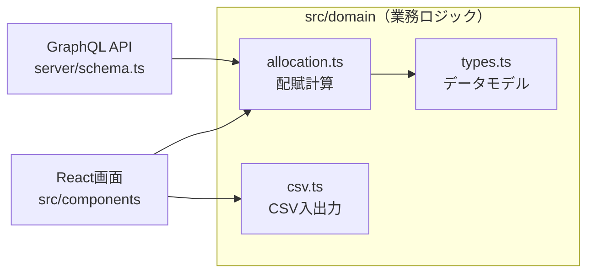
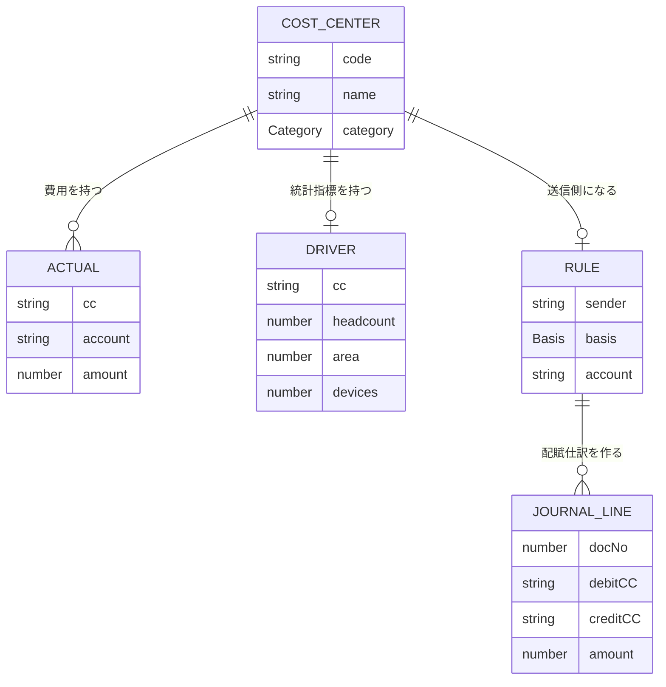

# 原価センタ配賦システム（TypeScript版）

共通部門（情報システム部、総務部、経営企画部）の費用を、人数、面積、端末台数などの基準で営業部門（支店）へ配賦し、配賦仕訳を自動作成する小さなERPです。SAP CO の配賦（Assessment）の考え方を簡略化して再現しました。

業務ロジックを画面から切り離し、同じロジックを **React の画面** と **GraphQL API** の両方から使う構成（Headless ERP の考え方）にしています。

**デモ**：https://eiennokoh.github.io/cost-center-allocation-ts/

（デモは画面のみです。GraphQL API はローカルで起動します）

## 背景

証券会社の企画部門で勤務していた際、国産ERPの導入プロジェクトで内部費用の配賦に関する要件定義を担当しました。当時は配賦基準の管理や計算をExcelで行っており、次の課題がありました。

- 配賦基準（人数、面積など）の更新漏れによる計算ミス
- 配賦前と配賦後の合計が一致しているかの確認に手間がかかる
- 配賦結果から仕訳を手作業で起こしている

このシステムは、その業務を「マスタ登録、配賦ルール定義、自動計算、仕訳作成」という流れに整理し直したものです。

## 技術スタック

| 分類 | 使用技術 |
|---|---|
| 言語 | TypeScript |
| 画面 | React、Vite |
| API | GraphQL（graphql-yoga、Node.js） |
| テスト | Vitest（業務ロジックと API の自動テスト） |
| 公開 | GitHub Actions でテスト後、GitHub Pages へ自動デプロイ |

## 構成



| ファイル | 役割 |
|---|---|
| `src/domain/types.ts` | データモデル（原価センタ、費用実績、配賦基準、配賦ルール、配賦仕訳）の型定義 |
| `src/domain/allocation.ts` | 配賦計算の本体。入力チェック、按分、端数調整、仕訳作成 |
| `src/domain/csv.ts` | CSVの取り込みと出力 |
| `src/domain/tables.ts` | 各マスタの列定義（画面とCSVで共通） |
| `src/domain/allocation.test.ts` | 配賦ロジックのテスト |
| `src/components/` | React の画面（マスタ編集、配賦結果、配賦仕訳） |
| `server/schema.ts` | GraphQL のスキーマとリゾルバ |
| `server/index.ts` | API サーバーの起動 |
| `server/schema.test.ts` | API のテスト |

## データモデル



## 配賦ロジック

```
配賦額 = 送信側の費用合計 × 受信側の基準値 ÷ 受信側の基準値合計
```

- 1円未満は四捨五入し、端数は配賦基準の値が最も大きい受信側に寄せて、送信額と受信額を必ず一致させます
- 入力チェック：マスタにない原価センタ、共通部門以外を送信側にしたルール、ルール重複、基準値が全部0のケースをエラーにします
- 今回は一段階配賦（共通部門から営業部門へ直接）です

## GraphQL API

```bash
npm run api
# http://localhost:4000/graphql をブラウザで開くと GraphiQL で試せます
```

配賦結果を取得する例：

```graphql
query {
  allocation {
    balanced
    totalBefore
    totalAfter
    lines { docNo debitCC creditCC account amount }
  }
}
```

配賦基準を更新する例（更新後に `allocation` を取得すると結果が変わります）：

```graphql
mutation {
  upsertDriver(input: { cc: "2100", headcount: 45, area: 300, devices: 60 }) { cc }
}
```

## SAP との対応

| このシステム | SAP S/4HANA |
|---|---|
| 原価センタ | 原価センタ（KS01） |
| 配賦基準 | 統計指標（KK01、実績入力 KB31N） |
| 配賦ルール | 配賦サイクル（KSU1） |
| 配賦実行 | 配賦の実行（KSU5） |
| 配賦用勘定 | 二次原価要素（原価要素カテゴリ 42） |

## 動かし方

```bash
npm install
npm run dev    # 画面（http://localhost:5173）
npm run api    # GraphQL API（http://localhost:4000/graphql）
npm test       # 自動テスト
```

## 今後の拡張

- 共通部門間の段階配賦
- 期間（会計月）ごとの実績管理
- データベースへの保存

## 開発について

業務要件の整理と計算結果の検証は自分で行い、実装には生成AI（Claude）を活用しました。

## 注意

データはすべて架空のサンプルです。
